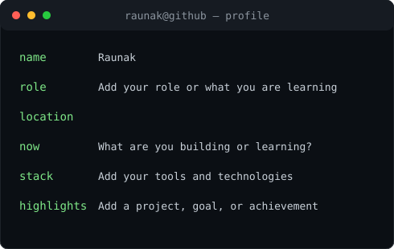

### `raunak@github ~ $ ./contributions.sh`

### `raunak@github ~ $ whoami`

<table><tr>
<td valign="top"></td>
<td valign="top"></td>
</tr></table>

### `raunak@github ~ $ ./links.sh`

[GitHub](https://github.com/RaunakEduc)

